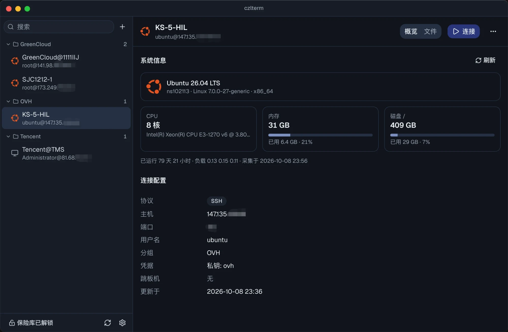
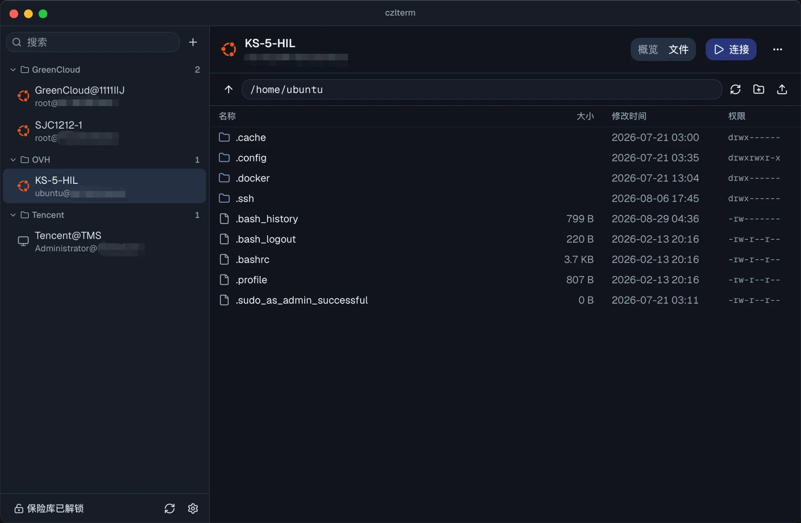
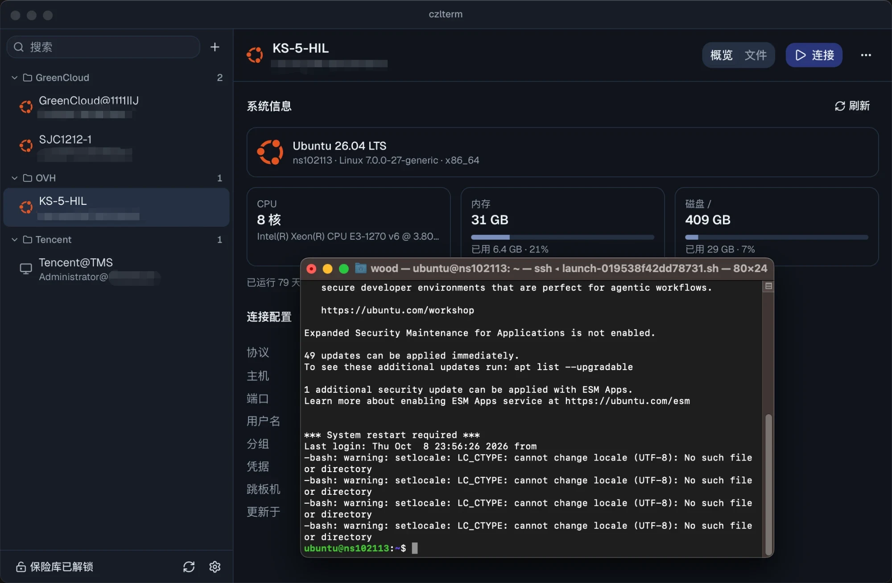
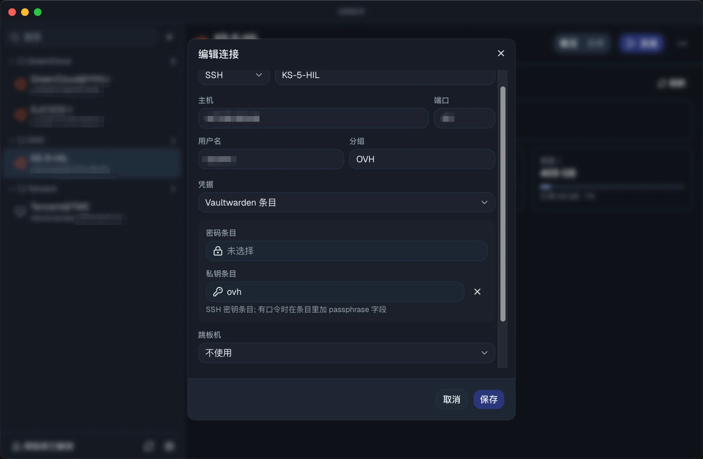
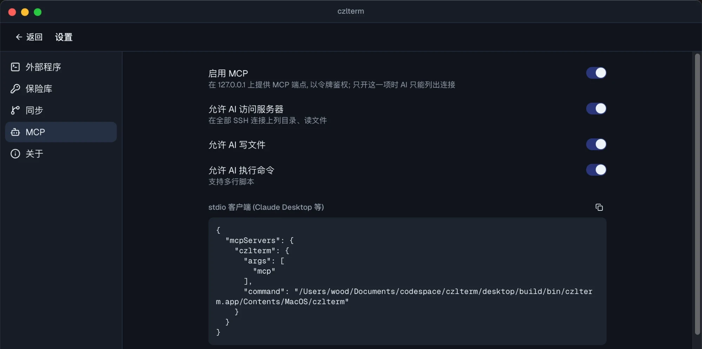
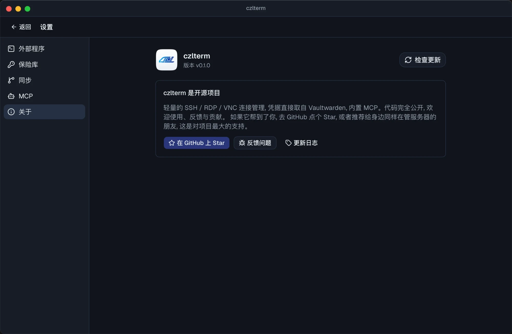

# czlterm

English | [简体中文](README.zh-CN.md)

A lightweight SSH / RDP / VNC connection manager for Windows and macOS. SSH runs your system OpenSSH in built-in terminal tabs, VNC opens in a built-in viewer, and RDP opens in the client you already have. czlterm keeps the connections and their credentials, browses remote files over SFTP, runs saved scripts, and lets AI clients work on your servers over MCP. Connections, scripts and credentials can sync across computers and be shared with a team, end-to-end encrypted.

- **Built-in terminal and VNC viewer**: SSH opens in terminal tabs inside the app, several at once; sessions keep running when the window is closed to the tray, and a tab that exits with an error can reconnect with Enter. You can switch to your system terminal in settings (Terminal, iTerm2, Ghostty, WezTerm, kitty, Windows Terminal, PowerShell). VNC opens in a tab (noVNC): it signs in to a Mac with username and password, scales the screen to the window and can pop out into its own window; Screen Sharing (macOS) or TigerVNC (Windows) are available instead. RDP uses Windows App on macOS and mstsc on Windows
- **Saved credentials**: store a username, password or SSH private key (paste it, drop the key file or pick it) in czlterm, encrypted with a key held in the system keychain; one credential can be used by many connections. Passwords and keys are never written into connection files or temporary SSH configs
- **Vaultwarden / Bitwarden (optional)**: connections can reference vault items instead, read through the official `bw` CLI and never written to disk. When a connection moves into a synced space, its vault references are converted into saved credentials so it works on other computers and for teammates
- **File manager**: browse, upload, download, rename and delete over SFTP; double-click a file to open it in VS Code (or your editor of choice), and it is uploaded back when you save
- **Scripts**: keep a library of commands and run one on any SSH connection; it runs in a terminal tab and leaves you in the shell afterwards
- **MCP**: AI clients can list your connections and, on servers you allow, read and write files and run commands
- **Cloud sync and teams (optional, paid)**: sign in with CZL Connect to sync connections, scripts and credentials across computers and share them with a team. Data is encrypted on your device and the server only stores ciphertext; a new computer is unlocked with your recovery code or approved from a signed-in device. In a team space, a connection someone else created or changed asks you to confirm its host and credential before connecting. Without signing in, everything stays on this computer and every other feature works the same
- **Machine info and host keys**: after each SSH connection, OS, kernel, CPU, memory, disk and uptime are collected in the background and shown on the overview page, and the list shows the matching OS logo. A changed host key is reported with the new fingerprint, and you choose whether to replace the old entry in `~/.ssh/known_hosts`
- **Desktop integration**: tray icon, optional launch at login, built-in updates, English and Chinese UI (follows the system language, switchable in Settings → General)
- Built with Go and Wails; the UI runs in the system WebView, no bundled browser engine

## Screenshots



| | |
|---|---|
|  |  |
| SFTP file manager; double-click to edit, saved back automatically | Connect opens a terminal tab (or your system terminal); czlterm supplies the key or password |
|  |  |
| Connections only reference credentials; no plaintext in the config | Tiered MCP permissions, multi-line scripts supported |
|  | |
| Built-in updates, verified against SHA-256 before installing | |

(Screenshots show the Chinese UI; English is also available.)

## Install

Download from [Releases](https://github.com/woodchen-ink/czlterm/releases):

- **Windows**: `czlterm-amd64-installer.exe`, installs per user into `%LOCALAPPDATA%\CZL\czlterm`, no admin rights needed
- **macOS**: `czlterm-darwin-universal.dmg`, universal for Intel and Apple Silicon. Signed with a Developer ID certificate and notarized by Apple; open the DMG and drag czlterm into Applications

Introduction and discussion (Chinese): [SunAI forum thread](https://www.sunai.net/t/topic/1533)

> **Prefer git sync, or no sign-in at all?** Starting with 2026.11.0, sync goes through CZL Connect (end-to-end encrypted, paid) and git sync to your own repository has been removed. If you want to keep git sync and never see sign-in features, stay on [v0.1.24](https://github.com/woodchen-ink/czlterm/releases/tag/v0.1.24) and skip the update prompt. Newer versions read the same data folder, so you can upgrade later.

## Requirements

- OpenSSH 8.4 or newer (needed for `SSH_ASKPASS_REQUIRE`). Windows 10 ships OpenSSH 8.1; upgrade with `winget install Microsoft.OpenSSH.Preview`
- Only if you use Vaultwarden / Bitwarden: the `bw` CLI, logged in once from a terminal, then unlocked with your master password inside czlterm
  ```bash
  npm i -g @bitwarden/cli
  bw config server https://your-vaultwarden
  bw login
  ```
  Store private keys as Bitwarden "SSH key" items. If a key has a passphrase, add a custom field named `passphrase` to the item

## Credentials

Each connection picks one source:

| Source | Behavior |
|---|---|
| Saved credential | Stored in czlterm, encrypted; syncs with its space and can be shared in a team space. A credential still used by connections cannot be deleted |
| Vaultwarden item | Uses only the selected password and/or key items. A missing password or key fails explicitly instead of falling back to system authentication |
| System default (SSH) | Plain OpenSSH with your own `~/.ssh/config`, keys and agent. These keys belong to each computer and do not sync |

Each jump hop has its own source. How secrets reach the external programs:

| Case | How |
|---|---|
| SSH private key | Each hop's key is decrypted into its own in-process ssh-agent and selected via `IdentityAgent` in that hop's temporary SSH config. System agents are never forwarded, and default disk keys are not tried |
| SSH password | ssh calls back into czlterm through `SSH_ASKPASS` and fetches the password with a one-time token. Password-only connections do not attempt public-key authentication; other prompts such as host key confirmation remain interactive |
| RDP (Windows) | Written temporarily to Credential Manager as `TERMSRV/<host>` and restored after 2 minutes: a credential you had saved for that host is put back, otherwise it is deleted |
| RDP (macOS) | Windows App does not accept passwords from outside, so the password is copied to the clipboard and cleared after 45 seconds |
| VNC (built-in) | The username and password are handed to the viewer page in the app; screen data is relayed through a token-protected WebSocket on 127.0.0.1. Nothing is written to disk |
| VNC (Screen Sharing, macOS) | Opened with a `vnc://` link. The password is not put in the link (command-line arguments are visible to other local users); it goes to the clipboard and is cleared after 45 seconds |
| VNC (TigerVNC, Windows) | A `-passwd` file is generated for TigerVNC and deleted after 2 minutes; other viewers fall back to the clipboard |

Temporary SSH configs contain no passwords or private keys and are removed when the terminal command exits or fails to start.

Locking the vault (manually or after the idle timeout) or quitting clears the agent endpoints, in-process SSH connections, VNC passwords held for reconnecting and the bw session. Optionally turn on "Remember unlock" in Settings → Vault to keep the bw session key in the system keychain across restarts; locking deletes it.

## MCP

Enable it in Settings → MCP and copy the config snippet:

- stdio clients (e.g. Claude Desktop): `czlterm mcp`
- HTTP clients (e.g. Claude Code): `http://127.0.0.1:47840/mcp` with a Bearer token

| Tool | What it does | Required permission |
|---|---|---|
| `list_connections` | Lists connections, no credentials | MCP enabled |
| `list_files` / `read_file` | Lists directories, reads files | "Allow AI to access servers" |
| `write_file` | Writes files | The above, plus "Allow AI to write files" |
| `run_command` | Runs a command or multi-line script (sent to `sh` over stdin; bash, zsh or powershell optional; working directory optional) | The above, plus "Allow AI to run commands" |

Credentials never leave the czlterm process.

## Updates

czlterm checks GitHub Releases 30 seconds after launch and every 6 hours after that. A new version is announced in the sidebar and can be installed from Settings → About. The installer is verified against `SHA256SUMS` before it runs.

## Data location

| OS | Path |
|---|---|
| macOS | `~/Library/Application Support/CZL/czlterm/` |
| Windows | `%LOCALAPPDATA%\CZL\czlterm\` |

Subfolders: `config/` local settings, sign-in record and encryption keys (encrypted with a key held in the system keychain), `data/` connections, scripts and saved credentials (`data/spaces/` holds the local copies of synced spaces), `logs/`, `cache/`.

## Build

```bash
go install github.com/wailsapp/wails/v2/cmd/wails@v2.12.0
cd desktop && wails build
```

Windows installer: `.\build.ps1` (needs NSIS). Pushing a `v*` tag makes GitHub Actions build the Windows installer and macOS DMG and publish them to Releases. Versions are numbered by release date, `vYEAR.MONTH.N` (for example `v2026.11.0`); versions up to v0.1.24 used semantic numbers, and the updater treats the date versions as newer.

## License

[AGPL-3.0](LICENSE)
