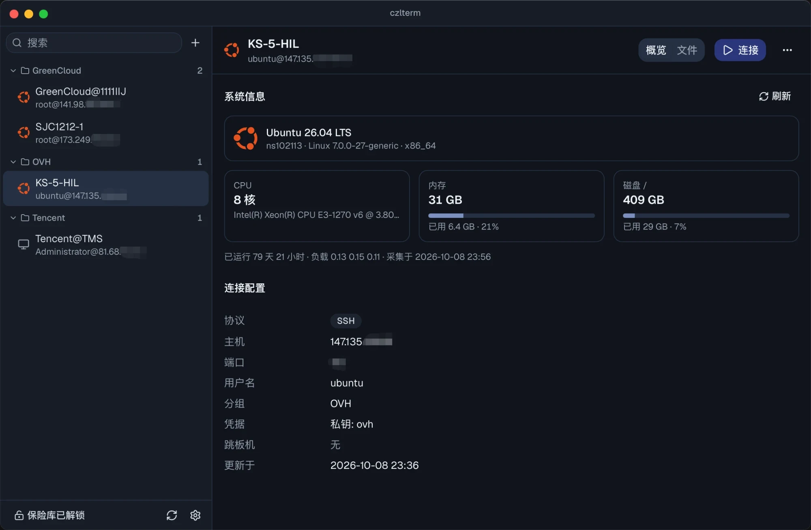
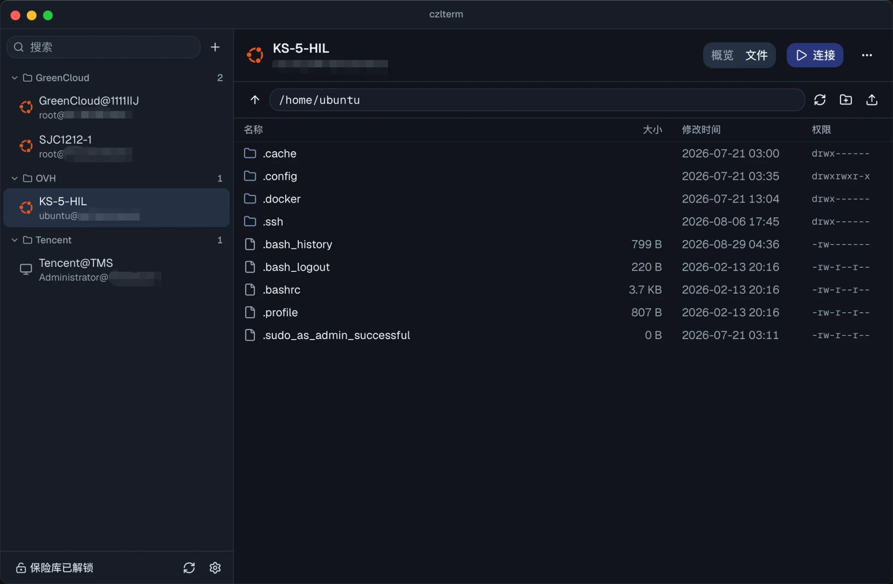
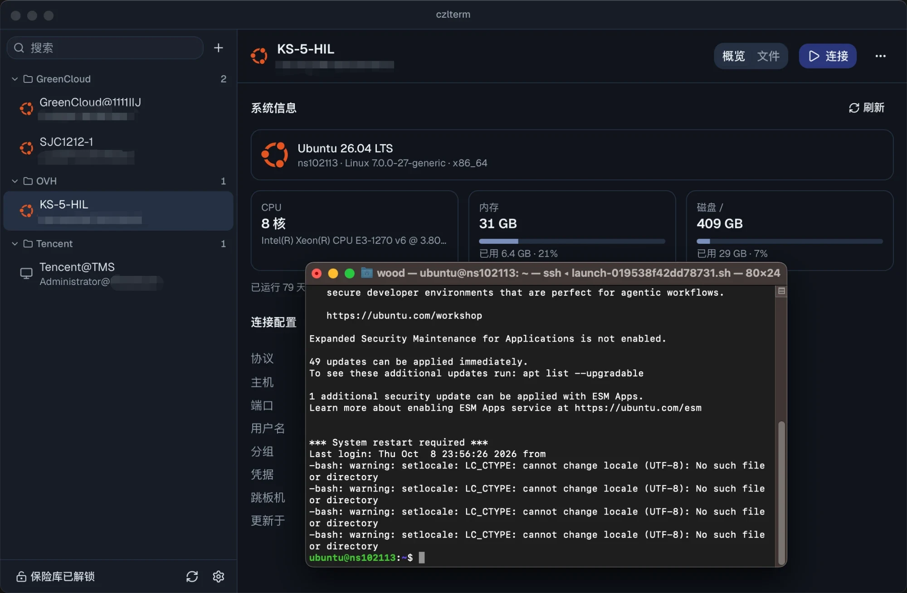
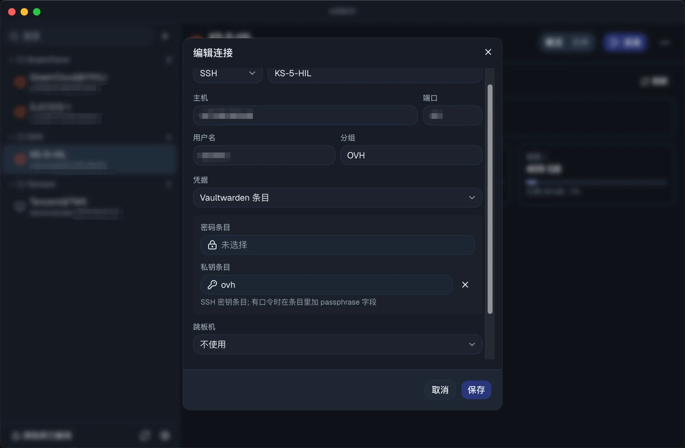
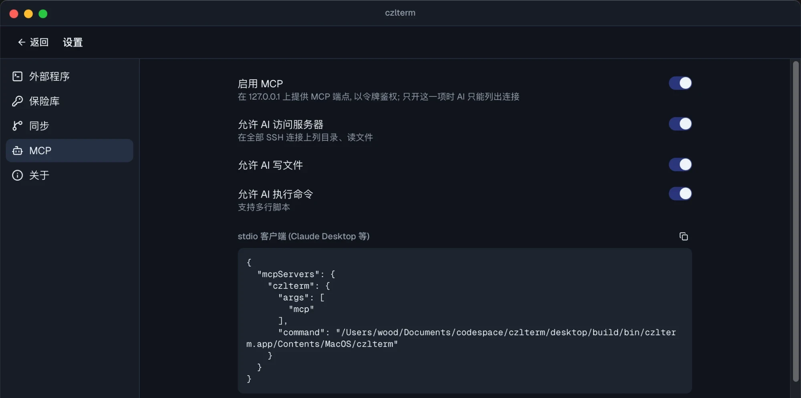
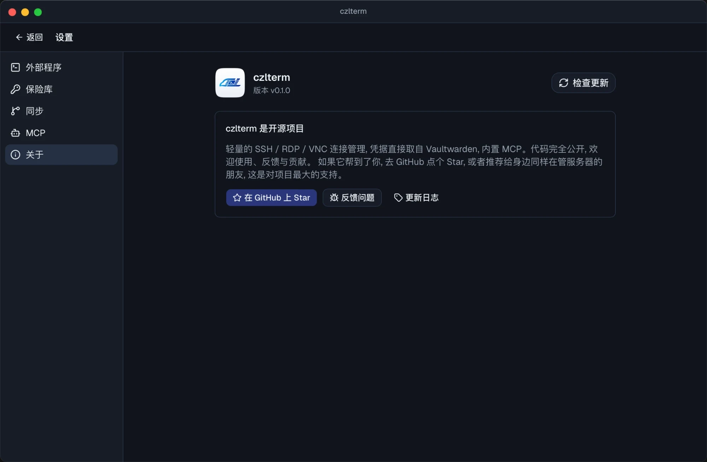

# czlterm

[English](README.md) | 简体中文

Windows 与 macOS 上的轻量 SSH / RDP / VNC 连接管理器。SSH 在内置的多标签终端里运行系统 OpenSSH，VNC 在内置查看器里打开，RDP 交给系统自带的客户端。czlterm 负责保管连接和凭据、通过 SFTP 管理远程文件、执行常用脚本，并通过 MCP 让 AI 操作你的服务器。连接、脚本与凭据可以在多台电脑间同步、与团队共享，全程端到端加密。

- **内置终端与 VNC 查看器**：SSH 默认在程序里的终端标签中打开，可同时开多个；窗口收进托盘后会话照常运行，异常退出的标签按 Enter 即可重连。也可以在设置里改用系统终端（Terminal、iTerm2、Ghostty、WezTerm、kitty、Windows Terminal、PowerShell）。VNC 在标签页里打开（noVNC），连 Mac 时用用户名和密码登录，画面随窗口缩放，可弹出成独立窗口；也可以改用屏幕共享（macOS）或 TigerVNC（Windows）。RDP 在 macOS 上用 Windows App，在 Windows 上用 mstsc
- **保存的凭据**：把用户名、密码或 SSH 私钥保存在 czlterm 里（粘贴、拖入私钥文件或选择文件），用系统钥匙串里的密钥加密存放；一条凭据可以给多个连接使用。密码和私钥不会写进连接文件或临时 SSH 配置
- **Vaultwarden / Bitwarden（可选）**：连接也可以引用保险库条目，通过官方 `bw` CLI 读取，不写入磁盘。连接移进同步空间时，保险库引用会自动转成保存的凭据，换电脑或团队成员也能直接用
- **文件管理**：通过 SFTP 浏览、上传、下载、重命名、删除；双击文件会用 VS Code 等编辑器打开，保存后自动传回服务器
- **常用脚本**：维护一份命令脚本库，在任意 SSH 连接上一键执行；脚本在终端标签里运行，跑完留在 shell 里
- **MCP**：AI 客户端可以列出连接，并在你授权的服务器上读写文件、执行命令
- **云同步与团队（可选，付费）**：登录 CZL Connect 后，连接、脚本与凭据可以在多台电脑之间同步，也能和团队共享。数据在本机加密后才上传，服务端只存密文；换电脑时用恢复码，或让已登录的设备批准来解锁。团队空间里别人新建或改过的连接，连接前会列出主机与凭据请你确认。不登录时数据只在本机，其它功能照常
- **机器信息与主机密钥**：每次 SSH 连接后，在后台采集系统、内核、CPU、内存、磁盘和运行时长，显示在概览页，连接列表里显示对应的系统图标。主机密钥变化时会提示新指纹，由你决定是否替换 `~/.ssh/known_hosts` 里的旧记录
- **桌面集成**：托盘图标、可选的开机自启、在线更新、中英文界面（默认跟随系统语言，可在 设置 → 通用 中切换）
- 基于 Go 和 Wails，界面用系统 WebView 渲染，不打包浏览器内核

## 截图



| | |
|---|---|
|  |  |
| SFTP 文件管理，双击用编辑器打开，保存后自动传回 | 连接时在终端标签（或系统终端）里打开，私钥和密码由 czlterm 自动提供 |
|  |  |
| 连接只引用凭据，配置里没有明文密码 | MCP 权限分级开关，支持多行脚本 |
|  | |
| 在线更新，下载后校验 SHA-256 | |

## 安装

从 [Releases](https://github.com/woodchen-ink/czlterm/releases) 下载：

- **Windows**：`czlterm-amd64-installer.exe`，按用户安装到 `%LOCALAPPDATA%\CZL\czlterm`，不需要管理员权限
- **macOS**：`czlterm-darwin-universal.dmg`，Intel 和 Apple Silicon 通用。已用 Developer ID 证书签名并通过 Apple 公证，打开 DMG 把 czlterm 拖进「应用程序」即可

介绍与讨论：[SunAI 论坛帖](https://www.sunai.net/t/topic/1533)

> **想继续用 git 同步、不需要登录功能？** 从 2026.11.0 起，同步改为经 CZL Connect（端到端加密，付费），git 同步到自己仓库的功能已移除。需要 git 同步、不想要登录相关功能的，可以自行保持使用 [v0.1.24](https://github.com/woodchen-ink/czlterm/releases/tag/v0.1.24)，出现更新提示时跳过即可。新版本读取同一个数据目录，以后想升级随时可以。

## 前置条件

- OpenSSH 8.4 或更高版本（`SSH_ASKPASS_REQUIRE` 从这个版本开始支持）。Windows 10 自带的 OpenSSH 是 8.1，需要升级：`winget install Microsoft.OpenSSH.Preview`
- 仅在使用 Vaultwarden / Bitwarden 时需要：`bw` CLI，在终端里登录过一次，之后在 czlterm 里输入主密码解锁
  ```bash
  npm i -g @bitwarden/cli
  bw config server https://你的-vaultwarden
  bw login
  ```
  私钥存成 Bitwarden 的「SSH 密钥」条目。如果私钥有口令，在条目里加一个名为 `passphrase` 的自定义字段

## 凭据

每个连接选择一种来源：

| 来源 | 行为 |
|---|---|
| 保存的凭据 | 加密保存在 czlterm 里，随所在空间同步，团队空间里成员共用。仍被连接引用的凭据不能删除 |
| Vaultwarden 条目 | 只使用所选的密码和 / 或私钥条目；缺少密码或私钥会直接报错，不回退系统认证 |
| 系统默认（SSH） | 原样使用 OpenSSH 与你自己的 `~/.ssh/config`、私钥和 agent。这些密钥属于每台电脑自己，不会同步 |

跳板链每一跳独立选择来源。秘密交给外部程序的方式：

| 场景 | 方式 |
|---|---|
| SSH 私钥 | 每一跳的私钥解密后放进独立的进程内 ssh-agent，通过该跳临时配置里的 `IdentityAgent` 交给系统 ssh；不透传系统 agent，也不尝试默认磁盘私钥 |
| SSH 密码 | 通过 `SSH_ASKPASS` 回调 czlterm，凭一次性令牌取密码；只选密码时不尝试公钥认证。主机指纹确认等其它提示仍由你自己回答 |
| RDP（Windows） | 临时写入凭据管理器 `TERMSRV/<host>`，2 分钟后还原：原来存过这台主机的凭据就写回去，没有就删除 |
| RDP（macOS） | Windows App 不接受外部传入的密码，所以把密码复制到剪贴板，45 秒后清除 |
| VNC（内置） | 用户名和密码交给程序里的查看器页面，画面经 127.0.0.1 上带令牌的 WebSocket 转发，不落盘 |
| VNC（屏幕共享，macOS） | 用 `vnc://` 链接打开。密码不放进链接（链接是命令行参数，同机其他用户能看到），而是复制到剪贴板，45 秒后清除 |
| VNC（TigerVNC，Windows） | 给 TigerVNC 生成 `-passwd` 文件，2 分钟后删除；其它查看器改用剪贴板 |

临时 SSH 配置不含密码或私钥，终端命令结束或启动失败时删除。

保险库锁定（手动锁定或空闲超时）或退出程序时，agent 端点、进程内的 SSH 连接、VNC 会话里留着用于重连的密码和 bw 会话都会被清除。可以在「设置 → 保险库」里打开「记住解锁」，把 bw 会话密钥存进系统钥匙串，重启后不用再输主密码；锁定时一并删除。

## MCP

在「设置 → MCP」里启用，然后复制配置片段：

- stdio 客户端（如 Claude Desktop）：`czlterm mcp`
- HTTP 客户端（如 Claude Code）：`http://127.0.0.1:47840/mcp`，用 Bearer 令牌鉴权

| 工具 | 说明 | 需要的权限 |
|---|---|---|
| `list_connections` | 列出连接，不含凭据 | 启用 MCP |
| `list_files` / `read_file` | 读目录和文件 | 设置里的「允许 AI 访问服务器」 |
| `write_file` | 写文件 | 上一项，再加设置里的「允许 AI 写文件」 |
| `run_command` | 执行命令或多行脚本（经标准输入交给 `sh`，也可选 bash、zsh、powershell，可指定工作目录） | 上上项，再加设置里的「允许 AI 执行命令」 |

凭据始终不离开 czlterm 进程。

## 在线更新

启动 30 秒后检查一次，之后每 6 小时检查一次 GitHub Releases。发现新版本后侧栏会提示，也可以在「设置 → 关于」里一键更新。安装包下载后先按 `SHA256SUMS` 校验，通过才会安装。

## 数据位置

| 系统 | 路径 |
|---|---|
| macOS | `~/Library/Application Support/CZL/czlterm/` |
| Windows | `%LOCALAPPDATA%\CZL\czlterm\` |

子目录：`config/` 放本机设置、登录记录与加密密钥（用系统钥匙串里的密钥加密），`data/` 放连接、脚本与保存的凭据（`data/spaces/` 是各同步空间的本机副本），`logs/` 放日志，`cache/` 放临时文件。

## 构建

```bash
go install github.com/wailsapp/wails/v2/cmd/wails@v2.12.0
cd desktop && wails build
```

Windows 安装包：`.\build.ps1`（需要 NSIS）。推送 `v*` 标签后，GitHub Actions 会构建 Windows 安装包和 macOS DMG 并发布到 Releases。版本号按发布日期编为 `v年.月.序号`（如 `v2026.11.0`）；v0.1.24 及以前是语义化版本号，在线更新会把日期版本认作更新的版本。

## 许可证

[AGPL-3.0](LICENSE)
